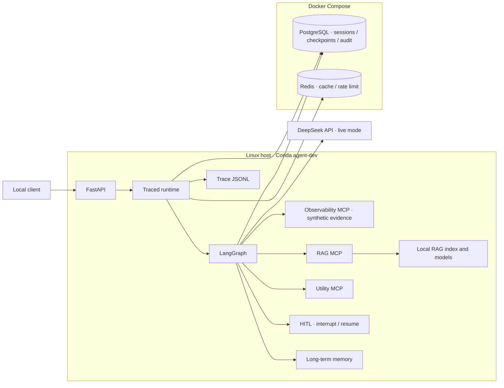

# AgentOps — Evidence-Driven RCA Agent

一个面向故障调查的 Python Agent。它通过 MCP 收集同一事故的指标、日志和调用链，在 LangGraph 中生成并校验结构化 RCA。证据不足时，系统会保留证据缺口。符合规则的模拟处置提案会暂停等待人工审批，重启后可从 PostgreSQL Checkpoint 读取状态。

**演示范围**：事故、遥测和执行回执均为教学模拟。即使人工批准，也只写模拟审计记录。

## 技术栈与工程实现

| 层 | 实现 |
|---|---|
| HTTP 与工作流 | Python 3.12、FastAPI、LangGraph、OpenAI 兼容的 DeepSeek 接口 |
| 工具与知识库 | MCP STDIO、FAISS、本地 Embedding 和 Reranker、长期 Memory |
| 持久化与限流 | PostgreSQL 16 会话映射、Checkpoint、审计。Redis 7 案例缓存与 Lua 原子限流 |
| 观测与容错 | Trace 关联请求、Graph 节点、LLM 和工具尝试。模型用量记录、异常分类、超时、有界重试 |
| 工程交付 | Docker Compose 混合部署、依赖与模型版本记录、离线回归、真实基础设施验收和恢复手册 |

- **证据约束**。Python 校验当前事故的证据 ID、支持来源与 RCA 结构。历史 Memory 只作为排查提示。证据不足时可返回 `insufficient_evidence`。
- **审批与恢复**。LangGraph 中断等待决定，使用同一 `thread_id` 恢复。白名单约束模拟动作，数据库唯一约束保护模拟审计的幂等写入。
- **失败边界**。只读遥测可有限重试。限流依赖故障拒绝消息，审批和数据库写入无自动重放。Trace 记录耗时、异常类型和 Token 计数。

## Architecture



**事故请求路径**：客户端 → FastAPI → Runtime 限流与会话检查 → LangGraph → 只读 MCP 证据 → RCA 校验 → 结束或 HITL 暂停 → Checkpoint / 模拟审计。普通问题可以进入 RAG 或通用工具分支。 [架构与模块说明](docs/architecture.md)

## Quick start

克隆后在 Linux 项目根目录执行。先安装 Docker Engine、Docker Compose 和 Conda，并按部署手册准备约 2.4 GB 的本地模型。Python 依赖和镜像另占空间。

```bash
conda env create -f environment.yml
conda activate agent-dev
bash scripts/manage.sh init
# 在 .env.docker 中设置本地 Embedding 和 Reranker 路径
bash scripts/manage.sh index
bash scripts/manage.sh up --offline
bash scripts/manage.sh health
```

`index` 从公开的合成知识库重建索引。PostgreSQL 和 Redis 由 Compose 启动，FastAPI、LangGraph 和 MCP 在宿主机运行。Dockerfile 构建 Redis 镜像。`--offline` 验收无需 DeepSeek Key，可验证健康检查、工具和状态持久化。生成 RCA 或 RAG 最终回答需要在本机配置 `DEEPSEEK_API_KEY`，然后以在线模式启动。使用 `bash scripts/manage.sh stop` 停止服务并保留数据。 [完整部署步骤](docs/deployment.md)

### API examples

```bash
curl -fsS http://127.0.0.1:8164/health
curl -fsS http://127.0.0.1:8164/api/v1/cases
curl -fsS -X POST http://127.0.0.1:8164/api/v1/sessions
```

真实 LLM 演示可在本机 [Swagger UI](http://127.0.0.1:8164/docs) 创建会话、向 `/api/v1/sessions/{session_id}/messages` 提交 `{"message":"请调查 INC-001"}`、通过 `/report` 读取 RCA，通过 `/pending` 检查提案。评测期间对模拟提案使用 `reject`。

## Testing

```bash
bash scripts/manage.sh test
```

- **离线回归**。发布副本包含 12 组测试脚本，覆盖 Lesson 64 原有的 10 组回归，另含评分与鲁棒性两组。组数与各脚本内的测试用例数分别统计。
- **真实基础设施验收**。使用独立 Compose 项目验证 PostgreSQL、Redis、HTTP、MCP 启动和 Checkpoint 重启恢复。测试状态由探针写入 Saver。
- **历史 DeepSeek 验证**。早期版本曾用真实 DeepSeek 调查合成事故。公开整理阶段调用的是离线测试或不依赖模型的真实基础设施探针。

具体证据与复现命令见 [测试说明](docs/testing.md) 和 [最终发布审计](docs/release/FINAL_GITHUB_AUDIT.md)。

## Limitations

单 Worker，API 无公网鉴权，监听回环地址。遥测和处置为合成演示。Redis 为非持久化缓存与计数。文件型 Memory 和 Trace 需要单独备份，Trace 无自动轮转。没有完成第二台全新服务器的端到端安装迁移，也没有生产可用性、准确率或负载基准。

## License

项目自有或获授权部分使用 [MIT](LICENSE)。依赖、镜像和模型遵循 [各自的上游许可](THIRD_PARTY_NOTICES.md)。

## Package layout

```text
app/
  app.main.py       # 唯一正式 FastAPI 入口 app.main:app
  api/          # HTTP 路由与请求校验
  core/         # 环境配置、稳定项目根路径、上下文预算
  agent/        # Runtime 继承链、LangGraph 工作流、HITL、Recovery
  rca/          # 证据规则与合成事故数据
  tools/        # MCP Client / Server / STDIO 脱敏启动器
  rag/          # 文档、Embedding、索引、检索、重排、生成
  memory/       # 长期 Memory 与检索配置
  storage/      # PostgreSQL / Redis 适配
  telemetry/    # Collector、Trace Callback 与报告
 evaluation/    # 独立评分与鲁棒性规则（不进入在线工作流）
 tests/         # 12 组离线回归与夹具
 scripts/       # 运维、索引、回归、真实工具探针和发布打包
 docs/          # 架构、部署、测试、安全与保留的发布证据
 verification/  # 已脱敏的验证证据
 documents/     # 公开合成知识库；本地生成的索引不提交
```

启动仍采用宿主机 API/MCP + Docker 数据服务；没有增加服务或新依赖。
模块启动示例：`python -m uvicorn app.main:app --host 127.0.0.1 --port 8164 --workers 1`。
知识库重建使用 `bash scripts/manage.sh index`，模块命令为 `python -m app.rag.ingest`。
跨目录运维可执行 `/absolute/path/to/project/scripts/manage.sh`；MCP 显式以项目根为 cwd 启动包模块。
部署的 Memory/Trace 继续使用既有目录名，不需要迁移数据库或重写 Checkpoint。
完整重构及验收结论见 [重构报告](docs/refactor/05_REFACTOR_FINAL_DECISION.md)。
