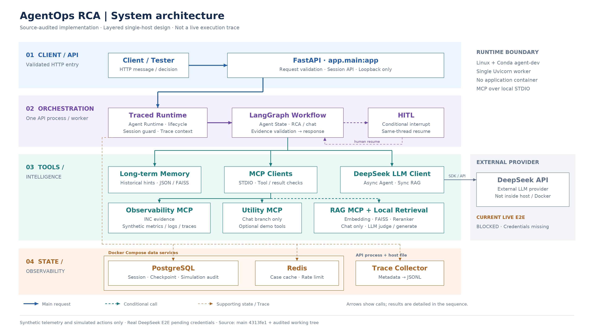
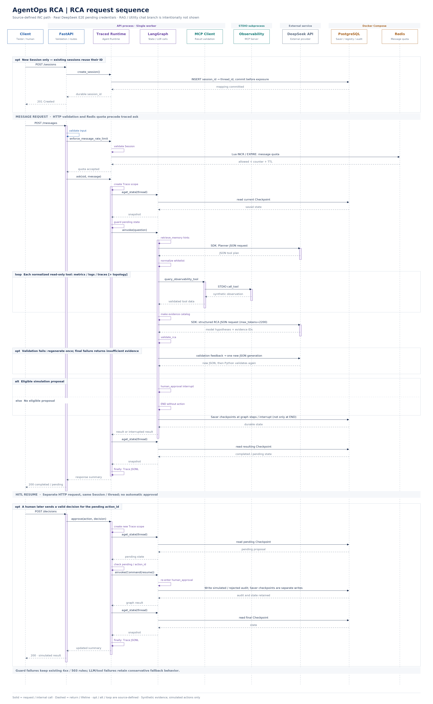
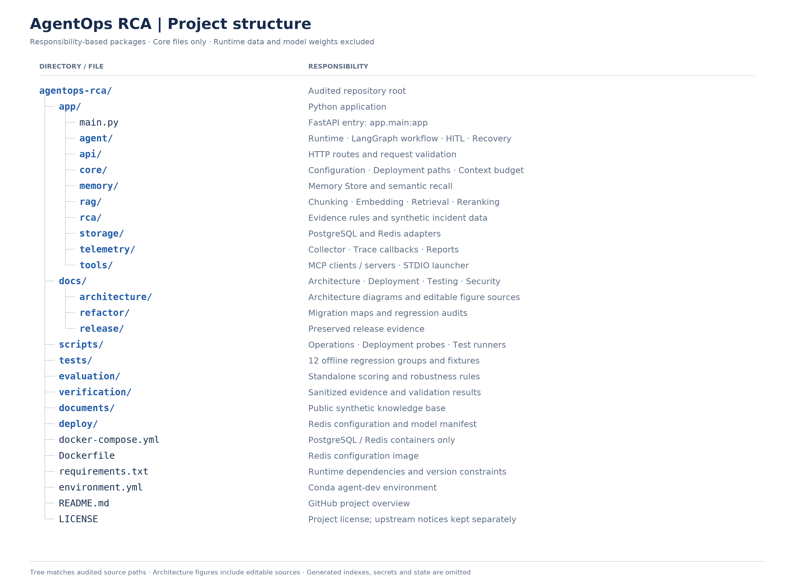

# AgentOps RCA

**Evidence-driven incident investigation with LangGraph, MCP and persistent execution state.**

一个面向微服务故障调查的 Python Agent 项目：将只读工具观测组织为证据目录，生成并校验结构化 RCA；需要人工决定的模拟处置暂停等待审批，并保存执行状态。

**范围说明：**事故、遥测和处置均为合成演示。DeepSeek 接入代码已实现；

## Architecture

[](docs/architecture/figures/01-system-architecture.svg)


主链是 Client → FastAPI → Traced Runtime → LangGraph；四层色带区分 API、编排、工具/推理和状态/观测。API 与 MCP 在宿主机运行，Docker Compose 仅管理 PostgreSQL / Redis，DeepSeek 是外部 Provider。

- **事故 RCA**：LLM JSON 规划 → 白名单 Observability MCP 收集**合成证据** → LLM 结构化 RCA → Python 校验 → 按条件中断等待人工决定。
- **普通问答**：模型选择工具时才调用 RAG / Utility；RAG 不在 `INC-*` 事故专用分支中。Memory 仅提供历史提示。
- **辅助能力**：细虚线表示存储/Trace支持关系，不是串行推理步骤。图示为实现关系，**不是已经通过真实 LLM 验证的运行记录**。


## Core Features

- **LangGraph workflow**：区分事故调查与普通问答，维护 Agent State 与执行分支。
- **MCP tool integration**：真实 STDIO Client / Server；事故工具只读，校验工具白名单与返回证据。
- **Local RAG retrieval**：本地 Embedding、FAISS、Reranker；普通问答可选择 `rag_query`，回答判断与生成仍需 LLM。
- **Human-in-the-loop**：提案符合规则才中断；人工决定恢复同一线程，动作只写模拟审计。
- **Persistent state**：PostgreSQL 保存 Session 映射、Checkpoint 和模拟审计。
- **Redis cache / rate limit**：案例目录 TTL 缓存与消息 Lua 原子限流，限流依赖失败时拒绝请求。
- **Trace / recovery**：关联请求、节点、工具、LLM 尝试与用量；错误分类及有界重试。
- **Docker Compose delivery**：PostgreSQL / Redis 容器，宿主机单 Worker API / MCP；提供启停、健康检查和备份工具。

## Tech Stack

| Category | Technology |
|---|---|
| Backend | Python 3.12 · FastAPI · Uvicorn |
| Agent | LangGraph · LangChain Core |
| LLM | DeepSeek API integration（真实 E2E 待凭据验证） |
| Tool Protocol | MCP STDIO |
| Retrieval | Sentence Transformers · FAISS · BGE Reranker |
| Database / Cache | PostgreSQL 16 · Redis 7 |
| Observability | In-process Collector · Trace JSONL |
| Deployment | Conda `agent-dev` · Docker Compose（数据服务） |

## Request Sequence

<details>
<summary>展开 RCA 请求 UML 时序：Session、LLM、MCP、Checkpoint 与 HITL</summary>

[](docs/architecture/figures/02-request-sequence.svg)


此图描述源码定义的 `INC-*` 诊断分支：请求/返回方向、真实STDIO接口、条件HITL与另一个HTTP请求中的同线程恢复。Trace在Runtime的finally中写入，Checkpoint由Saver在图步骤及中断时保存。批准也只产生模拟审计。

**Real DeepSeek E2E pending credentials.** RAG/Utility不在本事故分支，未为了凑参与者画成必经环节；本图不是一次已经成功执行的真实API日志。

</details>

## Project Structure

<details>
<summary>展开职责分包目录树</summary>

[](docs/architecture/figures/03-project-structure.svg)


树形结构来自已审计的真实核心路径，包含RCA、Storage、Telemetry等职责包。只列核心目录和文件，不展示权重、凭据、索引、数据库或其他运行产物。

</details>

[目录职责与模块边界](docs/architecture/project-structure.md)。

## Quick Start

先准备 Linux、Conda、Docker Compose，并按[部署手册](docs/deployment.md)配置约 2.4 GB 的本地模型；初次获取依赖和镜像可能需要网络。

```bash
conda env create -f environment.yml
conda activate agent-dev
bash scripts/manage.sh init
# 用本机编辑器设置 .env.docker 中的本地模型路径，保留凭据私密
bash scripts/manage.sh index
bash scripts/manage.sh up --offline
bash scripts/manage.sh health
```

默认 API 为 `127.0.0.1:8164`，文档入口 `/docs`。`--offline` 用于本地依赖与状态验收，不提供真实 LLM 诊断。真实演示需安全配置 `DEEPSEEK_API_KEY` 后以在线模式启动，并先补齐真实 E2E 验收。

```bash
bash scripts/manage.sh test
bash scripts/manage.sh stop   # 停止服务，保留持久化数据
```


## Limitations & License

单 Worker、无公网认证的本地演示 API；Collector 为进程内对象，Memory / Trace 需文件备份，Redis 计数非持久化。没有生产负载、生产遥测或第二台干净服务器的完整部署验证。

自有或获授权代码使用 [MIT](LICENSE)；依赖、模型及镜像遵循[第三方许可](THIRD_PARTY_NOTICES.md)。
