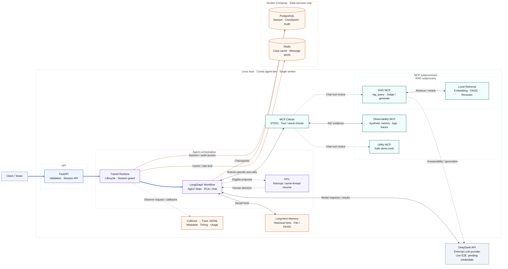
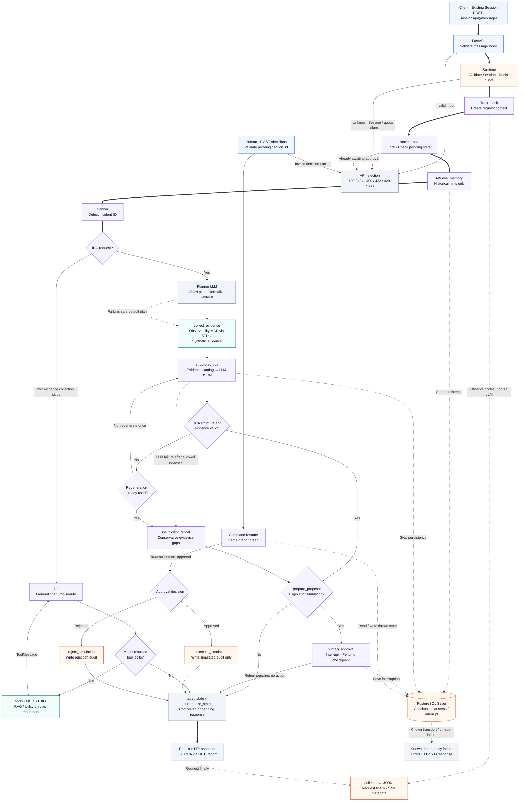

# 系统架构

本文描述源码已实现的运行关系。**最近一次真实 DeepSeek E2E 为 BLOCKED**：当前缺少 `DEEPSEEK_API_KEY`，真实 API 调用0次；独立模块验证不等于同链路验证。[最新结论](e2e/05_FINAL_E2E_DECISION.md)

## Overview

- **进程边界**：FastAPI / LangGraph 在宿主机 Conda `agent-dev` 单 Worker运行；三类 MCP 为同解释器启动的 STDIO 子进程。API 没有应用容器，DeepSeek 在外部。
- **基础设施**：Docker Compose 仅运行 PostgreSQL / Redis。Memory 与 Trace JSONL 为宿主机文件，模型权重外置。
- **连线语义**：粗蓝线为入口主链，双向线为请求/结果；虚线为条件调用，Observe 为旁路插桩；橙色细线为存储访问，不是推理步骤。
- **模块与进程**：Local Retrieval 在RAG子进程内运行，不是额外检索服务；Runtime、Graph、Collector均在同一API进程，不能把组件框误解为不同服务。
- **工具条件**：INC 分支调用只读 Observability MCP；普通问答才按 tool_calls 选择 RAG / Utility。RAG 的检索/重排本地运行，资料判断与生成仍调用外部 LLM。

[图源](architecture/overview.mmd) · [目录职责](architecture/project-structure.md) · [实现/验证审计矩阵](architecture/SOURCE_AUDIT.md)

## Request Flow

以下为**源码定义的顺序**，并非本轮真实 DeepSeek 请求的运行记录。使用已有 Session ID；新会话先经 `POST /api/v1/sessions` 注册。事故与普通问答是互斥分支，RAG不是事故必经步骤。

[流程图源](architecture/request-flow.mmd)。较详细的流程图用于技术讲解；README 只展示总体架构。

### 事故 RCA

1. `api/routes.py:send_message`完成输入验证，调用消息限流，再进入 traced `ask`。未知会话、限流与依赖故障按原规则拒绝。
2. `runtime.ask`在锁内检查旧状态，待审批时拒绝新消息；为 graph 传入同一 `thread_id`。
3. `workflow.py:create_graph`执行 retrieve_memory → planner → collect_evidence。无INC时 collect_evidence执行跳过，图中将这条无取证路径折叠到普通问答分支。
4. 事故Planner消费LLM JSON，Python `normalize_plan`维持必需工具和白名单；MCP返回内容经过事件/工具/synthetic校验，再形成证据目录。
5. structured_rca消费真实配置的模型输出，`rca_core.validate_rca`验证结构、引用和机制证据。最多一次校验重生成；调用或最终验证失败后保守降级。
6. `hitl.make_proposal`决定是否进入human_approval。中断时Saver保留状态，HTTP返回pending。后续 `/decisions` 校验提案与action_id，再通过Command恢复同一线程。批准也只写模拟审计，没有生产执行器。

事故Planner是JSON规划，不是原生工具调用ReAct循环。普通问答的llm节点才解析 `tool_calls`，按模型选择执行MCP、用ToolMessage回传并继续llm；只有rag_query才执行检索/重排与资料判断/回答生成。

### 状态与 Trace

Checkpoint在图步骤及中断过程中由Saver保存，图中细虚线是存储关系，不表示仅在末尾写一次。runtime读取最终或待审批state并返回摘要；完整结构化报告通过 `/report` 读取。已知数据库连接/超时异常由正式入口映射固定503；不重放不确定的审批或写操作。

`traced_runtime.ask/approve`使用run_scope与finally落盘摘要，回调关联节点，LLM/MCP span记录尝试与耗时。Trace写失败不应改变业务返回；它不是必须成功的推理阶段。Session/Incident关联在summary.events，API响应不额外提供顶层trace_id。

## Source Map

| Role | Source |
|---|---|
| API entry / routes | `app/main.py` · `app/api/routes.py` |
| Runtime chain | `app/agent/traced_runtime.py` → `redis_runtime.py` → `postgres_runtime.py` → `runtime.py` |
| Graph / State / HITL | `app/agent/workflow.py` · `app/agent/hitl.py` |
| Evidence rules | `app/rca/rca_core.py` · `app/rca/incident_mock_data.py` |
| LLM and MCP setup | `app/agent/postgres_runtime.py:start` · `app/tools/tool_config.py` |
| RAG / Memory | `app/rag/rag_pipeline.py` · `app/memory/memory_retriever.py` |
| Stores / Trace | `app/storage/` · `app/telemetry/` |
| Deployment | `scripts/manage.sh` → `scripts/manage.py` → `app.main:app` + Compose |

## Persistence & Limits

PostgreSQL保存HTTP Session映射、LangGraph Checkpoint和模拟审计；Redis只保存案例缓存和消息计数。Memory为历史提示，不取代当前事故证据。Session、Checkpoint、审计分别写入，不应宣称跨操作原子事务。

Collector为进程内有界5000事件队列；MCP子进程事件不自动汇总，父进程能记录工具耗时。文件Memory、Trace与Session缓存要求单Worker。模型、索引、凭据、Checkpoint和备份不随公开源码发布。

## Validation Boundary

源码实现、独立验证、同一真实LLM链路E2E是三个维度。12组离线回归、本地检索及三类STDIO已有独立证据；存储、HTTP、重启和恢复有历史真实基础设施证据。**没有一条已验收的真实DeepSeek驱动HTTP诊断结果**，不得以这些独立验证替代。[详细矩阵](architecture/SOURCE_AUDIT.md)

本次仅修改展示文档，不调用API、不改源码、不重跑数据库验收。缺少本地Mermaid渲染工具；图源已做静态一致性检查，实际字体、排版及GitHub渲染仍需人工预览确认。[设计检查报告](architecture/ARCHITECTURE_DESIGN_REVIEW.md)
