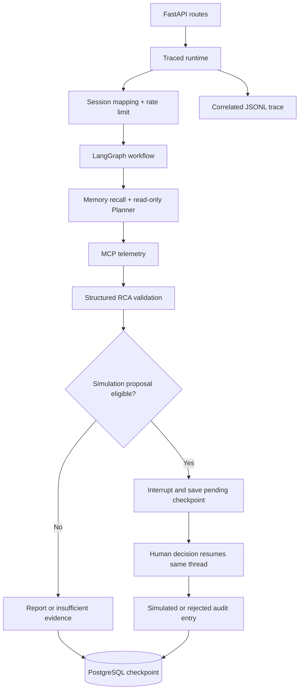

# 系统架构

## 正式模块与调用链

| 入口 / 模块 | 调用或依赖 |
|---|---|
| `app/main.py` | `app.api.routes.create_app`，使用 `app.agent.traced_runtime.InstrumentedAgentOpsRuntime`，为已知依赖故障提供 HTTP 503 |
| `app/api/routes.py` | `/messages` 先调用 `app.agent.redis_runtime` 限流，再调用 `app.agent.runtime.ask`。`/decisions` 调用 `app.agent.runtime.approve` |
| Runtime 继承链 | `app.agent.traced_runtime` → `app.agent.redis_runtime` → `app.agent.postgres_runtime` → `app.agent.runtime`。`app.agent.postgres_runtime` 初始化 PostgreSQL Saver 并构建图 |
| `app/agent/workflow.py` | `app.memory.memory_config` / `app.tools.tool_config`、`app.memory.memory_retriever`、`app.tools.observability_mcp_client`、`app.rca.rca_core`、`app.agent.hitl` |
| 工具进程 | `app.tools.tool_config.SERVERS` 通过同一 `sys.executable` 启动 RAG/Utility。PostgreSQL Runtime 按源码目录定位 `app/tools/observability_mcp_server.py` |
| RAG | `app.tools.rag_mcp_server` → `app.rag.rag_pipeline` → `app.rag.retriever`、`app.rag.reranker`、`app.rag.answerability`、`app.rag.generator`。`app/rag/ingest.py` 从 `documents/` 重建索引 |
| 数据 | `app/storage/postgres_store.py` 保存 `session_id` 到 `thread_id` 的映射及模拟审计。`app/storage/redis_store.py` 提供 TTL 缓存和 Lua 限流 |
| 观测与恢复 | `app/telemetry/observability.py` / `app/telemetry/trace_callback.py` 关联运行事件。`app/agent/recovery.py` 判断哪些调用可以重试，逐次记录尝试 |
| 评测与回归 | `evaluation/` 存放评分、跨次比较和回归规则，由离线测试导入。应用不导入这些评分模块 |
| 部署 | `scripts/manage.sh` → `scripts/manage.py` → Compose / 本地 Uvicorn。Uvicorn 加载 `app.main:app` |

## 状态和存储

`session_id` 标识 HTTP 会话，`thread_id` 标识 LangGraph Checkpoint，`trace_id` 关联一次 Agent 运行。调查和审批是两次请求。待审批时保留同一图线程，恢复时原中断节点重新进入。Checkpoint 和模拟审计分别写入，存在提交结果不确定的窗口。

PostgreSQL 会话、Checkpoint 与审计数据存放于独立命名卷。Redis 缓存与计数为临时数据。`app.core.deployment_config` 解析配置文件和数据目录，部署 Memory 和 Trace 保存在 `.deployment/data`。出于兼容考虑，数据子目录和 Trace 文件仍保留 `lesson49_agentops` / `lesson62_traces.jsonl` 这些旧名字。

Trace 只记录安全元数据、状态、耗时和用量。Checkpoints 可包含实际会话内容，因此与 Memory、Trace、运行日志和备份一起从公共交付排除。RAG 示例输入为合成文本，本地生成的索引与 pickle 不提交。使用自己生成或受信来源的索引文件。

## 包导入与路径

正式入口 `app.main:app` → `app.api.routes` → `app.agent.traced_runtime` → `app.agent.redis_runtime` → `app.agent.postgres_runtime` → `app.agent.runtime`。配置根使用 `app/core/deployment_config.py` 的 `parents[2]` 定位项目，不随 shell 工作目录漂移。MCP 使用 `python -m app.tools.*`，RAG 经过模块版 stderr 脱敏 launcher，stdout 仍为 JSON-RPC。RAG 索引继续位于项目根，Memory 与 Trace 保留原部署数据子路径。
