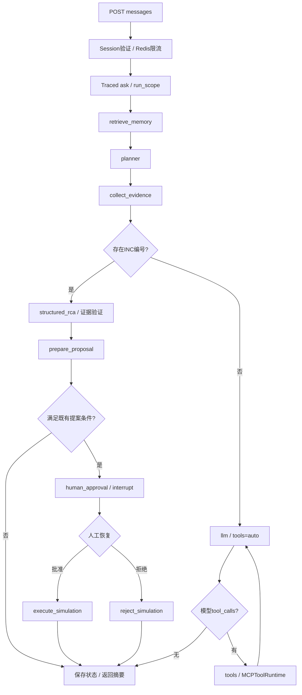

# 实际架构与调用链审计

审计日期：2026-11-23；项目 `/home/ubuntu/project/agentops-rca-public`，main，基线4313fe1。本轮真实E2E因当前项目没有DEEPSEEK_API_KEY而BLOCKED。下述调用链来自源码审计，不把它当成本轮执行轨迹。

## 正式 HTTP 入口

入口 `app/main.py:create_recovery_app`，复用 `app/api/routes.py:create_app`，注入 `app/agent/traced_runtime.py:InstrumentedAgentOpsRuntime`。已知连接/超时异常返回固定503；APIProblem与验证异常沿用原处理。lifespan启动Runtime，退出时close，不是单独聊天Client冒充业务入口。

| 接口 | 正式作用 |
|---|---|
| GET /health | API生命周期及Redis健康；不包含完整PG健康检查 |
| GET /api/v1/cases | 静态合成事故目录，Redis案例缓存 |
| POST /api/v1/sessions | 创建HTTP Session → PostgreSQL thread映射，201 |
| GET /api/v1/sessions/{sid} | 读取图Checkpoint摘要 |
| POST /api/v1/sessions/{sid}/messages | 校验输入与Session，Redis限流，然后svc.ask触发Agent |
| GET /api/v1/sessions/{sid}/report | 读取已保存结构化RCA |
| GET /api/v1/sessions/{sid}/pending | 待审批状态与提案 |
| POST /api/v1/sessions/{sid}/decisions | 恢复同一线程的人工审批，不能绕过已有审批规则 |
| POST /api/v1/sessions/{sid}/reset | 切换线程，保留历史Checkpoint；待审批时拒绝 |
| GET /api/v1/audit | 模拟动作审计 |

`runtime.py:summarize_state`返回status、answer、incident_id、diagnosis_status、validation、pending、proposal、simulation_result。messages响应没有独立顶层session_id/trace_id字段；sid在URL，Trace关联信息在落盘摘要events中。结构化完整报告用/report读取，不应臆造新响应Schema。

## Runtime 与资源

`InstrumentedAgentOpsRuntime → RedisPostgresAgentOpsRuntime → PostgresAgentOpsRuntime → AgentOpsRuntime`。

`postgres_runtime.py:start`创建AsyncPostgresSaver并setup、SessionRepository、PostgresSimulationAudit、AsyncOpenAI、MemoryStore/SemanticMemoryRetriever、MCPToolRuntime、独立Observability STDIO Client，然后构建图；Redis层随后ping并接入生命周期栈。Session先提交PG再对外暴露。没有修改任何schema或释放顺序。

## 事故路径与一般问答路径

依据：`app/agent/workflow.py:create_graph`及其add_node/add_edge；不是根据README推断。

事故Planner使用真实模型返回JSON中的tools，经normalize_plan保证必需证据工具和白名单；collect_evidence通过Client.call_tool拿到观测；structured_rca用当前证据目录和受限历史Memory调用模型，validate_rca验证引用与机制证据，失败最多重生成一次，再保守降级。Pythonrender_report将模型已校验结构呈现为文字，因此固定模板呈现不等于硬编码诊断。HITL只在make_proposal条件满足时中断，批准也仅模拟审计，无生产修复。

**事故路径不是原生Tool Calling ReAct循环。**它是LLM JSON规划 → Python受控STDIO收证 → LLM结构化诊断。一般问答的llm_node才解析原生tool_calls并执行tools→llm循环；两者不能互相替代验收结论。

## MCP 与 RAG 的真实接入边界

- `app/tools/tool_config.py:SERVERS`定义真实STDIO：同一解释器 `-m app.tools.mcp_stdio_launcher app.tools.rag_mcp_server`，以及Utility模块。cwd明确为项目根。launcher仅stderr脱敏，stdout保留JSON-RPC。
- PostgreSQL Runtime另启动 `-m app.tools.observability_mcp_server`；`observability_mcp_client.py`发现并验证四类只读工具，校验incident_id、synthetic、tool、data，拒绝泄露expected_cause。
- RCA必需get_service_metrics/search_logs/query_traces，拓扑可选；服务返回确定的合成数据，没有连接生产监控。
- RAG并非游离死代码：一般问答可由模型选择rag_query，进入rag_pipeline → Embedding/FAISS → Reranker → LLM answerability → 必要时LLM generator，再作为ToolMessage返回Agent。
- **INC事故专用分支没有rag_query调用边**，不能因为启动RAG Server或Memory用了Embedding就宣称RAG参与了事故诊断。即便后续INC-001成功，仍需标记事故RAG未覆盖。
- Memory是历史提示，RAG是文档检索，MCP事故观测是当前合成证据，三者不可混同。evaluation评分模块不进入在线工作流；expected_cause只供评测，不传给模型或工具响应。

## 状态与可观测性

Redis处理消息Lua限流与案例TTL缓存，不保存权威会话/Checkpoint。LangGraph通过AsyncPostgresSaver保存执行状态、中断与消息；SessionRepository保存HTTP映射，审计表记录模拟批准/拒绝。TraceCallback记录节点，tracked_chat_completion记录LLM尝试和成功响应usage，MCP客户端span记录工具耗时。traced_runtime的finally保存JSONL，events携带Session/Incident关联。

Collector为每进程5000事件内存队列，单Worker；MCP子进程内部collector不会自动聚合。父进程工具span可观察调用。本轮没有真实Agent请求，因此这些正式链路的状态/trace写入未被实际触发。
